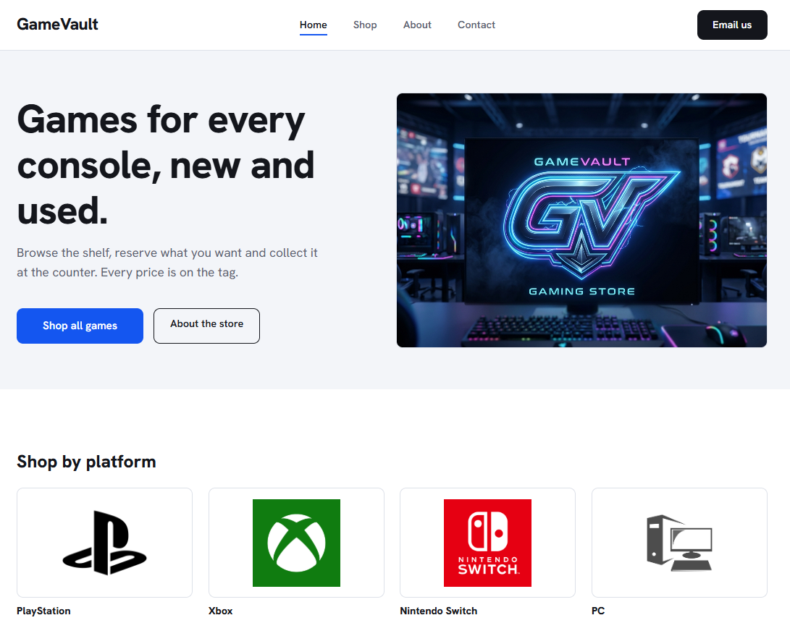

🌐 [Live site](https://apms07.github.io/gamevault-website/)

## English

Multi-page online store template for a video game shop, built with HTML and CSS only. It is the storefront for the [GameVault inventory app](https://github.com/apms07/GameVault).

**Features**

- Responsive layout for desktop, tablet and phone
- CSS animations that respect the reduced motion setting
- Image slots filled by dropping files into the `images` folder
- Reserve button that opens an email with the game title

**Tech stack:** HTML, CSS

**How to run:** download the repo and open `index.html` in a browser.

---

## Português

Modelo de loja online com várias páginas para uma loja de videojogos, feito só com HTML e CSS. É a montra do [gestor de inventário GameVault](https://github.com/apms07/GameVault).

**Funcionalidades**

- Layout adaptável a computador, tablet e telemóvel
- Animações em CSS que respeitam a definição de movimento reduzido
- Espaços de imagem preenchidos ao colocar ficheiros na pasta `images`
- Botão Reservar que abre um email com o título do jogo

**Tecnologias:** HTML, CSS

**Como executar:** descarrega o repositório e abre o `index.html` no navegador.
